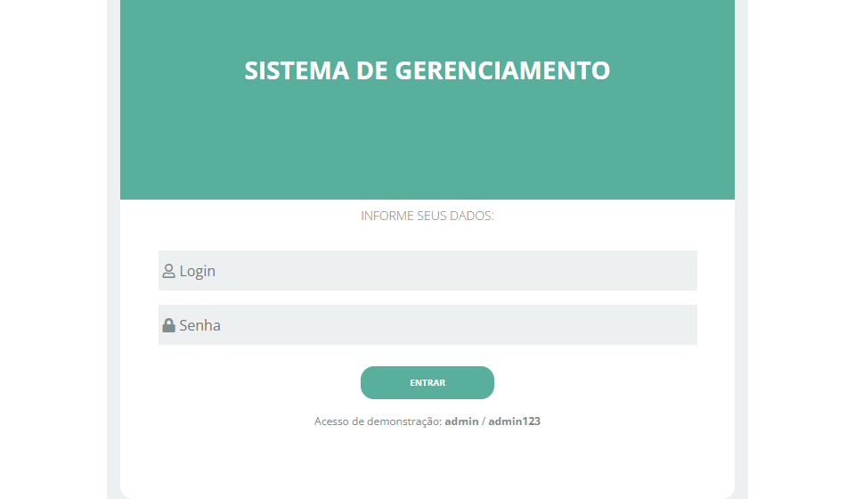
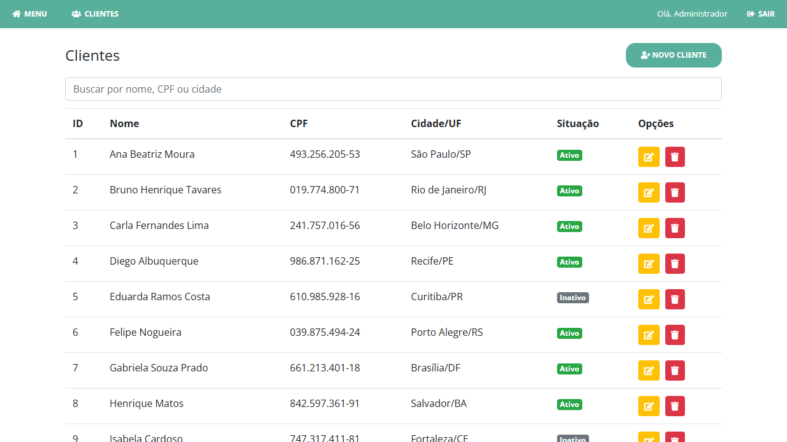
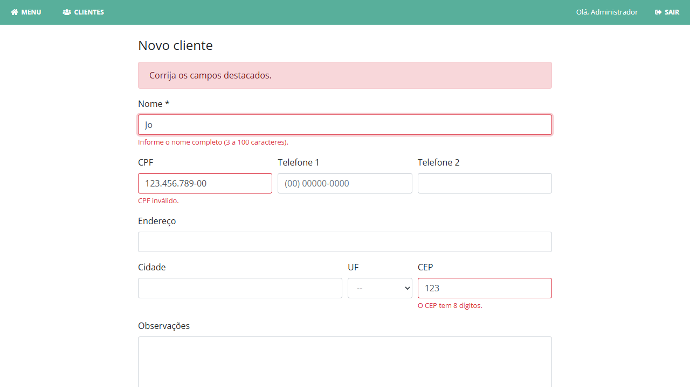
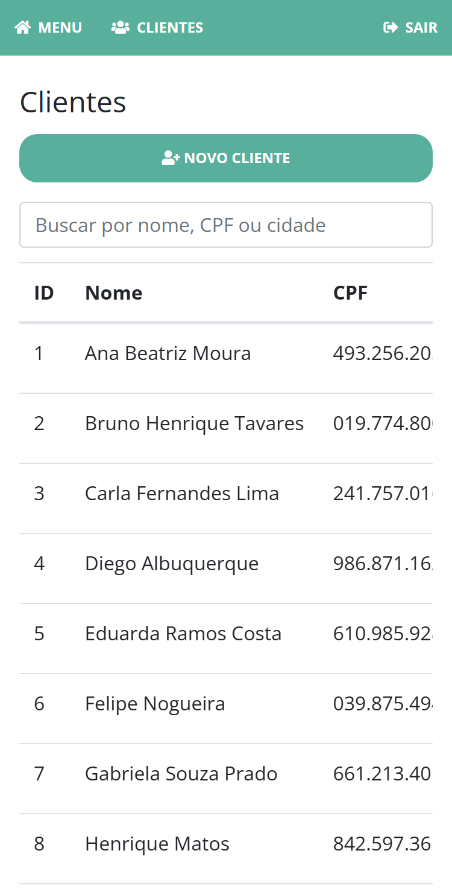

<div align="center">

# SGS · Gestão de Clientes em PHP

**Meu primeiro sistema de gestão:** login e cadastro de clientes em PHP puro com MVC. Escrito em 2021 e revisado em 2026.




</div>

> **2021 → 2026:** mesma stack, código revisado. SQL concatenado virou prepared statement, a senha ganhou hash,
> a saída passou a ser escapada e o ambiente sobe com um comando. Veja a tabela [Antes x depois](#antes-x-depois).

| Lista de clientes | Validação no servidor | Celular |
|---|---|---|
|  |  |  |

## Por que fiz

Em 2021 eu queria entender como um sistema web funciona por baixo, sem framework: rotas, sessão, banco e HTML na mão.
Em 2026 voltei nele para corrigir o que eu não sabia na época, sem trocar a stack. É o registro do começo da minha jornada.

## Funcionalidades

- 🔐 **Login** com sessão e senha guardada em hash (`password_hash` / `password_verify`)
- 👥 **CRUD de clientes:** cadastro, listagem, edição e exclusão
- ✅ **Validação no servidor:** nome, CPF (dígitos verificadores), telefone, UF e CEP, com o erro ao lado de cada campo
- 🔎 **Busca e ordenação** por coluna na tabela
- 🛡️ **Proteção contra SQL injection, XSS e CSRF**
- 📱 **Layout que funciona no celular**
- 🐳 **Banco pronto:** o Docker cria as tabelas e carrega dados fictícios

## Como rodar

Precisa de [Docker](https://docs.docker.com/get-docker/) com Docker Compose.

```bash
git clone https://github.com/wandercosta/sgs-gestao-clientes-php.git && cd sgs-gestao-clientes-php
cp .env.example .env
docker compose up --build
```

Abra http://localhost:8080 e entre com **admin** / **admin123** (usuário de demonstração criado pelo `script.sql`).

Se a porta 8080 estiver ocupada, troque `APP_PORT` no `.env`. Para começar com o banco zerado: `docker compose down -v`.

## Antes x depois

| | 2021 | 2026 |
|---|---|---|
| Consultas | SQL montado por concatenação (`"... WHERE login='$login'"`) | PDO com prepared statements em todas as consultas |
| Credenciais do banco | fixas no `init.php` | `.env` fora do Git, documentado no `.env.example` |
| Senhas | comparadas em texto puro | `password_hash` / `password_verify` |
| Saída no HTML | dados impressos sem escape | tudo passa por `htmlspecialchars` (função `e()`) |
| Validação | só `required` no HTML | validação no servidor, com mensagem por campo |
| Exclusão | link GET sem confirmação | POST com token CSRF e confirmação |
| Sessão | login só redirecionava; páginas internas abertas | sessão obrigatória nas páginas internas |
| Mensagens | `alert()` via `<script>` | mensagens na própria página |
| Banco | `script.sql` só tinha a tabela de livros de outro projeto | `usuarios` e `clientes`, com dados fictícios |
| Ambiente | PHP e MySQL instalados na máquina | `docker compose up` |
| Celular | só a tela de login se adaptava | navegação, tabela e formulário responsivos |
| Código morto | módulo de livros e telas sem uso | removido |

## Tecnologias

- PHP 8.3 puro (PDO, sessões), sem framework e sem Composer
- MySQL 8.4
- HTML, CSS e JavaScript puros, com Bootstrap 4 e Font Awesome via CDN
- [sorttable.js](https://www.kryogenix.org/code/browser/sorttable/) para ordenar a tabela
- Docker e Docker Compose (Apache + PHP e MySQL)

## Estrutura de pastas

```
.
├── index.php              # tela de login
├── init.php               # carrega o .env, configura sessão e tratamento de erros
├── lib/funcoes.php        # escape de saída, CSRF, mensagens, formatação
├── model/                 # acesso ao banco (PDO)
│   ├── banco.php          #   conexão
│   ├── usuario.php        #   busca de usuário para o login
│   └── cliente.php        #   CRUD e validação de clientes
├── controller/            # recebem o formulário, chamam o model e redirecionam
│   ├── ControllerEntrar.php / ControllerSair.php
│   ├── ControllerListar.php / ControllerEditar.php
│   └── ControllerSalvar.php / ControllerDeletar.php
├── view/                  # páginas HTML + PHP
├── css/ e js/             # estilo e scripts do navegador
├── script.sql             # estrutura do banco + dados fictícios
├── Dockerfile
├── docker-compose.yml
└── .env.example           # variáveis de ambiente com valores de exemplo
```

## O que aprendi

- Concatenar entrada do usuário em SQL é abrir a porta; prepared statement resolve, e é tão simples quanto.
- Escapar a saída tem o mesmo peso que validar a entrada: um nome de cliente pode carregar um `<script>`.
- Sem sessão, "login" é só uma tela. Cada página interna precisa conferir quem está ali.
- Credencial no código vai parar no Git. O `.env` e o `.env.example` resolvem isso desde o primeiro commit.
- Um `docker compose up` que sobe tudo, banco incluído, vale mais que qualquer passo a passo de instalação.
- Reler código antigo mostra o quanto evoluí, e também o que ainda vale a pena manter simples.

---

A tela de login partiu do layout das videoaulas de [Guilherme Chinaglia](https://www.youtube.com/channel/UCEkMd3Bw_bVUuGbXU0sFPSg). Todos os nomes, CPFs e endereços do `script.sql` são fictícios.
